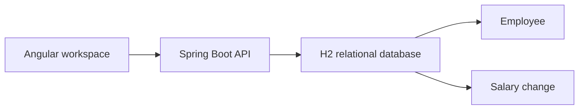

# Design and engineering decisions

## Scope and ownership

HR owns the salary correction workflow. The roster is a deterministic demo dataset with six departments and six work countries. Pay insights reflect current annual base pay in each group's own currency. The dashboard uses the same country and department filters as the directory and computes headcount across the entire selection. An employee name search applies to the directory.

## Data integrity and access

The employee row stores current pay and a revision number. The client sends the revision it reviewed. A conditional update and a history insert run in one transaction. A competing write returns HTTP 409 and the UI asks the editor to reload. Pay values are integer minor units. Reporting uses exact decimal arithmetic and rounds to the nearest minor unit, ties up. Each write records the authenticated HR username and a UTC timestamp.

Spring Security protects the API through a server-side session and CSRF tokens. The assessment has one configurable HR account. Use synthetic records on the shared demo. A real HR rollout would need organizational SSO, independent editor identities, access reviews, and a backup and recovery policy.

## Performance and deployment

Directory queries return a bounded page in employee ID order and an exact count. Country and department have indexes. Case-insensitive substring matching may scan the roster. For exact medians, the API reads two columns for up to 10,000 matching employees and groups the sorted amounts by currency. This bounds work at the assessment scale and keeps pagination independent from reporting. Revisit query plans and percentile computation if the roster grows significantly.

The Angular UI and API share an origin in one executable Java application. The assessment uses one instance with a mounted H2 volume. That keeps the rollout small and retains changes across process restarts. The application applies an idempotent initial schema at startup. Adopt versioned migrations and an external relational service before adding replicas or live schema changes.

## AI-assisted development

Codex turned the brief into a scoped requirements document, implemented the application, and exercised the verification steps. The repository history records the progression. Decision prompts guiding the work included:

- What can HR learn when salaries are stored in different currencies?
- How should the application behave if two HR sessions edit the same salary?
- Can we prove a failed audit insert leaves the current salary intact?
- Does the demo run from a clean database with exactly 10,000 employees?

